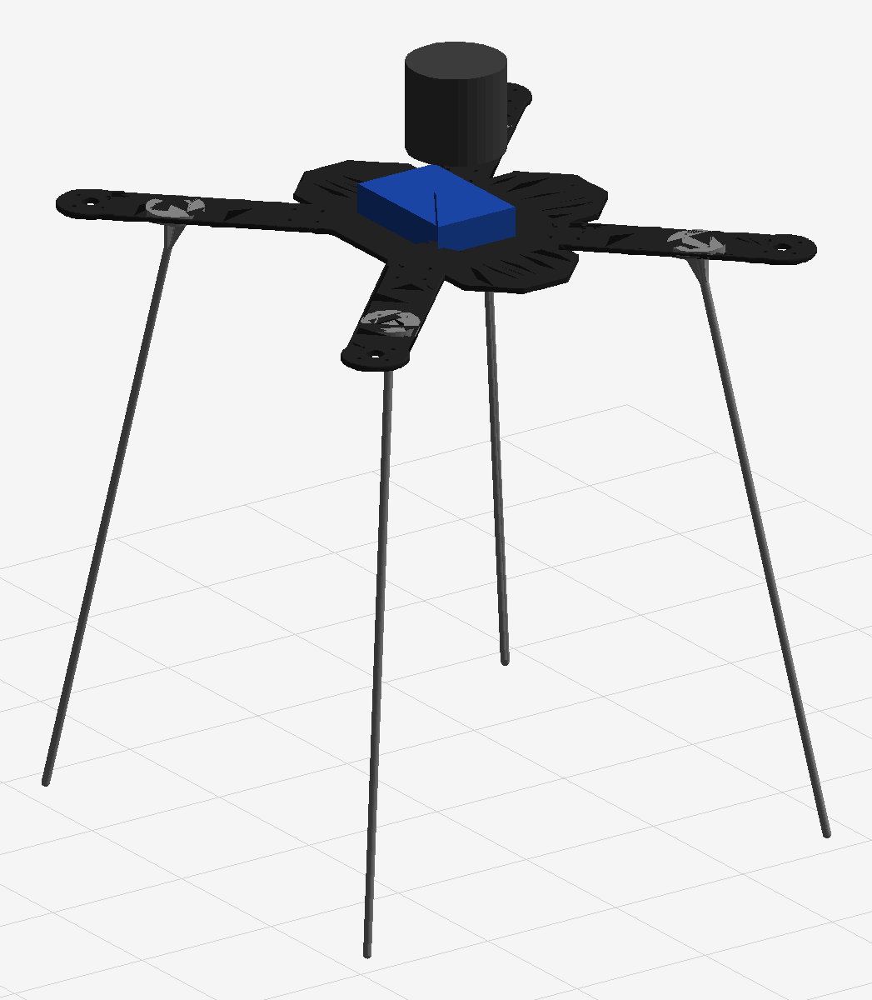

# drone_description

ROS Noetic URDF + TF launch for:

- 机架底板 `STL` → `meshes/base_plate.stl`
- 飞机腿 `STL` ×4 → `meshes/landing_leg.stl`
- PX4 flight controller (box)
- Livox MID-360 (cylinder approximation)



## 1. TF tree

```text
camera_init                 FAST-LIO world frame (published by FAST-LIO)
└── body                    MID-360 internal IMU = FAST-LIO body
    ├── lidar_link          MID-360 LiDAR frame
    │   └── livox_frame     frame published by Livox ROS Driver 2
    └── base_link           PX4 / flight-controller body frame, FLU
        ├── flight_controller
        ├── px4_imu_link
        ├── px4_frd         FRD frame for PX4-style consumers
        ├── base_plate
        │   ├── landing_leg_front_left
        │   ├── landing_leg_front_right
        │   ├── landing_leg_rear_right
        │   └── landing_leg_rear_left
        └── base_footprint  ground frame
```

Important:

- `body` is the **MID-360 internal IMU**, i.e. the frame FAST-LIO calls `body`.
- `base_link` is at the **PX4 flight-controller centre**, FLU axes.
- `lidar_link` uses the official FAST-LIO MID-360 extrinsic:

  ```yaml
  extrinsic_T: [-0.011, -0.02329, 0.04412]
  extrinsic_R: [1, 0, 0,
                0, 1, 0,
                0, 0, 1]
  ```

  So in the URDF:

  ```xml
  <origin xyz="-0.011 -0.02329 0.04412" rpy="0 0 0"/>
  ```

- `body -> base_link` is assumed to be **0.02 m vertically**. Adjust
  `body_to_base_link_joint` if your MID-360 sits higher/lower.

## 2. Build

```bash
cd ~/catkin_ws/src
# put drone_description here
cd ~/catkin_ws
catkin_make
source devel/setup.bash
```

## 3. Real-machine TF launch

```bash
roslaunch drone_description real_robot.launch
```

This starts:

- `robot_state_publisher`, which publishes all fixed transforms from the URDF;
- a static transform `lidar_link -> livox_frame` (identity);
- optional RViz.

If your Livox driver uses another frame name:

```bash
roslaunch drone_description real_robot.launch livox_frame:=livox_frame
```

To run without RViz:

```bash
roslaunch drone_description real_robot.launch rviz:=false
```

## 4. How TF is built on the real robot

### 4.1 Static part: URDF + robot_state_publisher

`robot_state_publisher` reads `robot_description` and publishes all **fixed**
joint transforms:

```text
body -> lidar_link
body -> base_link -> base_plate -> legs
body -> base_link -> flight_controller
...
```

There are no moving joints, so `joint_state_publisher` is not needed.

Check:

```bash
rosrun tf2_tools view_frames.py
evince frames.pdf
```

or:

```bash
rosrun tf tf_echo body base_link
rosrun tf tf_echo body lidar_link
```

### 4.2 Dynamic part: FAST-LIO

FAST-LIO publishes:

```text
camera_init -> body
```

The URDF then completes:

```text
camera_init -> body -> lidar_link
camera_init -> body -> base_link -> base_plate/legs/FC
```

So for FAST-LIO + MID-360, use:

```yaml
common:
  lid_topic: "/livox/lidar"
  imu_topic: "/livox/imu"

mapping:
  extrinsic_est_en: false
  extrinsic_T: [-0.011, -0.02329, 0.04412]
  extrinsic_R: [1, 0, 0,
                0, 1, 0,
                0, 0, 1]
```

Do **not** add another `body -> something` transform from another node; the
URDF already provides it.

### 4.3 PX4 / MAVROS

For PX4 external position estimation, send FAST-LIO odometry to MAVROS:

```text
/Odometry  ->  /mavros/odometry/out
```

Typical bridge:

```xml
<remap from="/mavros/odometry/out" to="/Odometry"/>
```

or a small relay node.

**Do not let MAVROS publish `odom -> base_link` at the same time as the URDF
publishes `body -> base_link`.** That gives `base_link` two parents and TF
will complain.

Recommended setup for this URDF:

- FAST-LIO owns the TF: `camera_init -> body`.
- Disable the MAVROS TF plugin, or at least do not publish `odom -> base_link`.
  For example, in the MAVROS launch:

  ```xml
  <param name="local_position/tf/send" value="false"/>
  ```

  The exact parameter namespace depends on your MAVROS version; the goal is
  simply: only one node may publish a parent for `base_link`.

- PX4 still receives external odometry via `/mavros/odometry/out`; TF and
  mavlink odometry are independent.

If you must use PX4/MAVROS TF instead of FAST-LIO TF:

- disable FAST-LIO's `camera_init -> body` broadcast;
- change the URDF so `base_link` is the root (not a child of `body`);
- publish PX4's `odom -> base_link`;
- add a static `base_link -> body` transform for the MID-360.

This is a different TF ownership model; do not mix the two.

## 5. Check the real-machine TF

Start the Livox driver and FAST-LIO, then:

```bash
rosrun tf tf_echo camera_init body
rosrun tf tf_echo body lidar_link
rosrun tf tf_echo body base_link
rosrun tf tf_echo base_link base_footprint
```

Expected:

- `body -> lidar_link`: translation `(-0.011, -0.02329, 0.04412)`, identity rotation.
- `body -> base_link`: translation `(0, 0, -0.02)`.
- `base_link -> base_footprint`: translation `(0, 0, -0.4155)`.

Also check that no frame has two parents:

```bash
rosrun tf2_tools view_frames.py
```

## 6. Frames for PX4

- `base_link`: FLU, at FC centre.
- `px4_imu_link`: same pose as `base_link`.
- `px4_frd`: FRD frame, rotated 180° about X from `base_link`.

If your PX4/MAVROS setup uses FRD, use `px4_frd` in your own code or add the
appropriate static transform. Do not rotate `base_link` itself unless you also
rotate the whole robot model.

## 7. What to adjust on the real machine

1. `body_to_base_link_joint`
   - currently `(0, 0, -0.02)`.
   - measure the vertical distance between the MID-360 IMU reference point
     and the PX4 FC centre.

2. `lidar_joint`
   - currently the official MID-360 extrinsic.
   - keep it unless you have a calibrated custom extrinsic.

3. `base_plate_joint`
   - currently `-0.01175 m` from FC centre to plate mid-plane.

4. `base_footprint_joint`
   - currently `-0.4155 m` from FC centre to ground.
   - if you change the leg length or mounting, update this so the feet touch
     `z = 0`.

5. Leg mounting points
   - currently `±0.12 m` in X/Y, feet at about `±0.18 m`.
   - edit the four `landing_leg_*_joint` origins if your frame holes differ.

6. FC / LiDAR sizes
   - FC box: `0.09 × 0.06 × 0.02 m`
   - LiDAR cylinder: `r = 0.0325 m`, `length = 0.06 m`
   - edit the `<box>` / `<cylinder>` values if needed.

## 8. Files

```text
urdf/drone.urdf              robot model and fixed transforms
launch/real_robot.launch     real-machine TF launch
launch/display.launch        RViz-only display launch
rviz/drone.rviz              RViz config
meshes/base_plate.stl        base plate
meshes/landing_leg.stl       one landing leg, used four times
doc/preview.png              preview image
```
